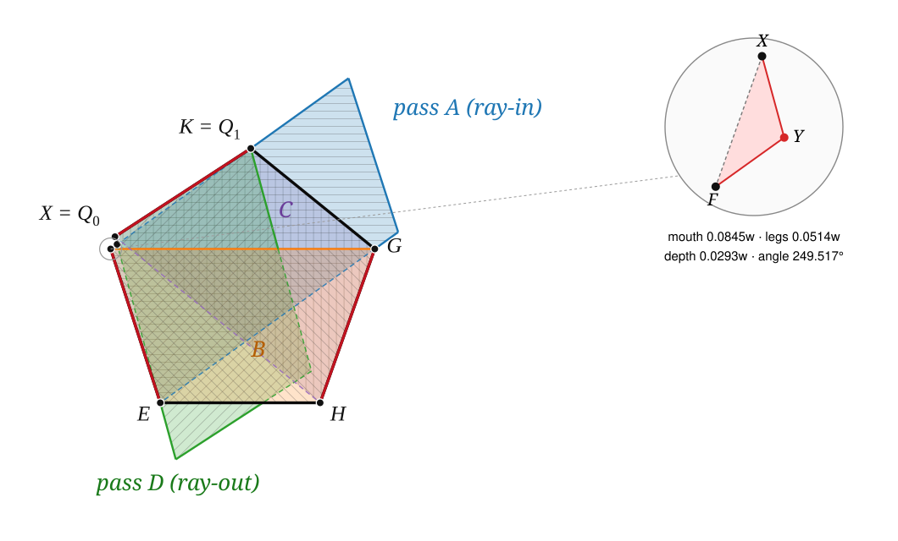

# Two notions of tightness for the flat overhand knot

[Read the paper (PDF)](paper/main.pdf) · [Reproduce the results](REPRODUCE.md) · [Cite the manuscript](CITATION.cff)

An overhand knot folded flat in a strip has two ways to measure tightness. On the three-crease branch with layer order **B > D > A > C**, the regular pentagon strictly minimizes truncation length locally. A certified path decreases core length from the pentagon to a different strict local minimum, the notched state θ†.

[](paper/figs/theta-dagger-heptagon.svg)

**Figure 6 from the paper.** The notch lies on the mirror axis of θ†. Its mouth is about 0.0845 strip widths across. Compare the [regular pentagon in Figure 2](paper/figs/fig1-pentagon.svg) and the [two core-length curves in Figure 4](paper/figs/fig4-two-families.svg).

## Run the certificates

```sh
uv sync --locked
sh scripts/verify-core.sh
```

A successful run ends with `PASS: core certificates, mutation controls and figure checks`. The [reproducibility guide](REPRODUCE.md) gives the inputs, methods and expected results for Theorems A–H, along with commands for the longer numerical searches.

## Results and scope

| Result | Evidence |
|---|---|
| The three-crease trefoil has crossing word `XYZXYZ`, alternating crossings and slope signs unique up to mirror. A compatible global order is uniquely B > D > A > C. Loose configurations can realize cyclic local orders. | Combinatorial enumeration, an explicit realization, and a common four-panel overlap near the two optima and along the certified paths. |
| Kauffman's pentagon is a strict local minimum of truncation length. Core length has a feasible descent direction there. | Exact Farkas certificate for truncation and an eight-wall descent certificate for core length. |
| θ† is a strict local minimum of core length. Its coordinate field has degree 12 and the associated sextic has Galois group S₆. | Exact elimination and stationarity, interval curvature bounds and an exact four-panel outline. |
| The figure-eight state has core length 4√15/3 and truncation length 32√15/15. | Exact panel validity and a strict local minimum on the stated eight-contact chamber. |

The model uses zero-thickness ribbons and movable complete creases. Global optimality across all branches, full census root coverage and finite-thickness pulling dynamics are open. The [Lean project](formal/README.md) proves 16 supporting algebraic statements.

## Materials

| Path | Contents |
|---|---|
| [paper](paper/) | LaTeX manuscript, compiled PDF and figures |
| [verify](verify/) | Exact certificates, interval checks and numerical experiments |
| [Recorded figure-eight search](verify/artifacts/n4-rerun-20261023/) | Inputs, source snapshots, checkpoints and per-stage results |
| [logs](logs/) | Recorded output and SHA-256 manifests |
| [Ancillary archive](https://github.com/yongsk0066/flat-overhand-knot/raw/refs/heads/main/ancillary.tar.gz) | Current public distribution including the manuscript PDF |

## Citation and license

Yongseok Jang is the author. The full manuscript citation is in [CITATION.cff](CITATION.cff). Code is distributed under the [MIT license](LICENSE). The paper and figures are © 2026 Yongseok Jang, [CC BY 4.0](https://creativecommons.org/licenses/by/4.0/).
